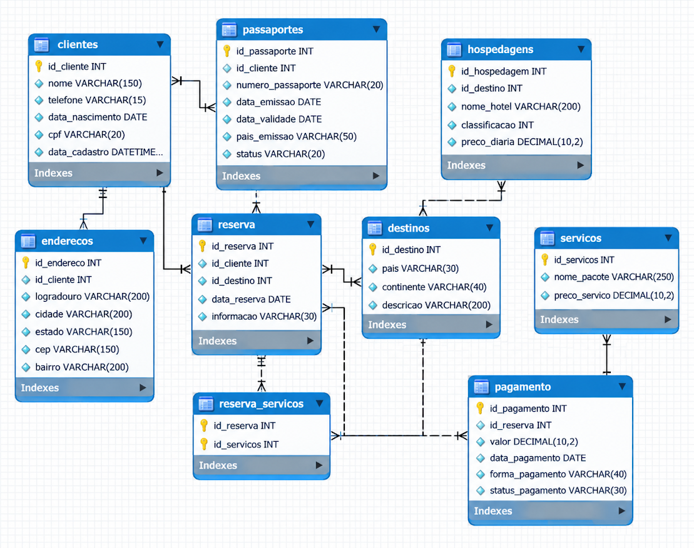
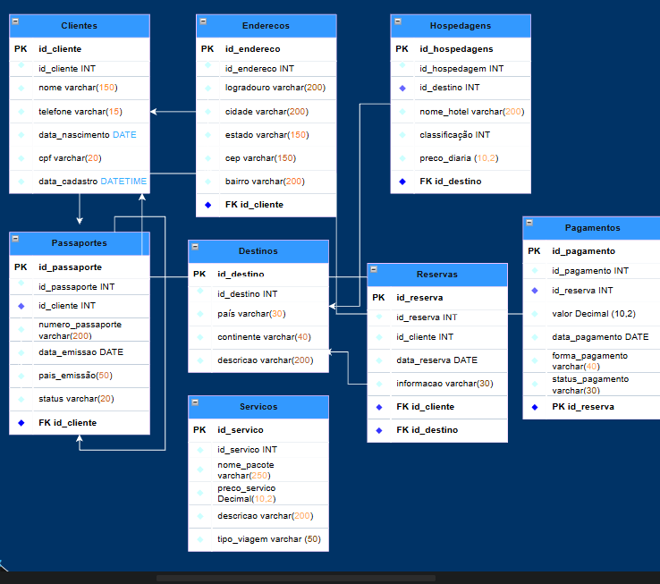
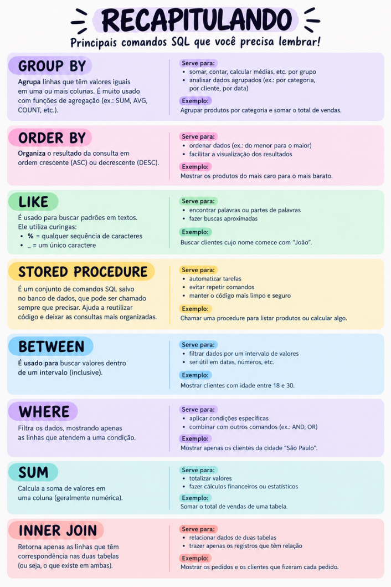

**Banco de Dados — Agência de Viagens**

**Sobre o projeto**
Projeto de banco de dados para uma agência de viagens, com foco em identificar e solucionar problemas na organização e no gerenciamento de informações.

**Sobre a MundiTravel**
Nossa empresa **MundiTravel** tem como diferencial preços incríveis oferencido com pacotes muito bem avaliados pelo nossos clientes,buscamos o melhor conforto e uma viagem inesquecível.

**Objetivo**
Organizar os dados de clientes, destinos, reservas e pagamentos, reduzindo erros, duplicidades e dificuldades no atendimento.

**Tecnologias**
- SQL
- MySQL
- MySQL Workbench

**Problemas que buscamos resolver**
- Informações desorganizadas;
- Reservas com dados incorretos;
- Registros duplicados;
- Dificuldade no controle de pagamentos.

**Soluções**

- Banco de dados completo
- Dados atualizadose horários definidos
- Preços comprometidos com o que mostra
- Usar técnicas que melhora o atendimento
  

#Modelagem:

**Tabelas Criadas**

**Métodos Usados Para o Banco**

**Cardinalidade(RELACIONAMENTOS)**

• Clientes ─── Enderecos (1:1 ou 1:N)
• Clientes ─── Passaportes (1:N)
• Clientes ─── Reservas (1:N)
• Destinos ─── Reservas (1:N)
• Destinos ─── Hospedagens (1:N)
• Reservas ─── Pagamentos (1:1)

**Tutorial Do DUMP**

No seu Banco(Ex: WorkBench)

vai em server e vai aparecer isso

**DATA EXPORT**

clique e seleciona o Banco que deseja:

(Meu Banco) **MUNDITRAVEL**

no canto esquerdo embaixo temos **STRUCTURE AND DATA**
**obs:Mantenha essa opção pois salva a estrutura e os dados!**

o banco(WorkBench) ja seleciona automaticamente as tabelas,porém você pode escolher qual deseja salvar.

e antes de salvar selecione o local da pasta que deseja exportar.

Para o ultimo passo:

No canto superior estará escrito 

**Export Progress**

e clique em **START EXPORT**

Assim Você salva seu banco!

